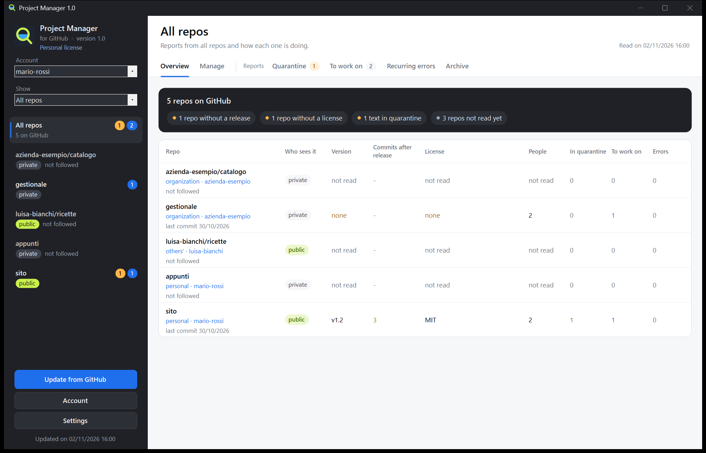

# Project Manager (for GitHub)

[English](README.md) | [Italiano](README.it.md) | [Français](README.fr.md) | [Español](README.es.md) | **Deutsch**

Ein Windows-Programm, mit dem Sie Ihre GitHub-Repos über Schaltflächen verwalten, ohne Git zu kennen: Repos erstellen und ändern, einen Ordner hochladen, Releases veröffentlichen, festlegen, wer daran arbeitet. Es liest außerdem, was auf Ihren Repos ankommt (Issues, Kommentare, Pull Requests und die Berichte mit dem Fehlerprotokoll von WeightMonitor), hält verdächtige Texte zurück, bevor Sie damit arbeiten, und bereitet die Arbeit für einen Chat mit Claude Code vor.

**Das Programm spricht Italienisch, Englisch, Französisch, Spanisch und Deutsch.** Sie wählen die Sprache beim ersten Öffnen und können sie jederzeit unter **Einstellungen** ändern.

Weder mit GitHub verbunden noch von GitHub empfohlen.

## [Project Manager herunterladen](https://github.com/nscentart/Project-Manager-for-GitHub/releases/latest/download/ProjectManager.exe)

Der SHA-256-Fingerabdruck der Datei steht in den Notizen auf der Seite [Releases](https://github.com/nscentart/Project-Manager-for-GitHub/releases). Das Programm aktualisiert sich nicht selbst: Laden Sie zum Aktualisieren die Datei erneut herunter.



*Das Programmfenster, auf Englisch, mit Beispieldaten.*

## Installation

Es gibt nur eine Datei: `ProjectManager.exe`. Öffnen Sie sie und wählen Sie **Installieren** oder **Ohne Installation verwenden**.

- **Installieren** kopiert sie nach `%LOCALAPPDATA%\Programs\ProjectManager` und legt sie ins Startmenü, sodass Sie das Programm über die Windows-Suche finden. Sie brauchen weder Administratorrechte noch ein anderes Programm: kein Git und kein .NET zum Herunterladen.
- Zum Aktualisieren öffnen Sie die Datei der neuen Version und wählen erneut **Installieren**: Ihre Konten und Daten bleiben erhalten.
- Wenn Sie Project Monitor (den alten Namen) hatten, fragt Project Manager, ob Ihre Daten und Zugriffsschlüssel auf den neuen Namen übernommen werden sollen, ohne dass Sie sich neu anmelden müssen. Wenn Sie ablehnen, wird nichts angerührt. Beim Installieren darüber wird die alte Kopie (Programm, Eintrag im Startmenü, Eintrag unter Installierte Apps) nur entfernt, wenn es wirklich die alte Version dieses Programms ist. Das alte Programm muss geschlossen sein.
- Zum Entfernen: Windows-Einstellungen > Installierte Apps. Zugriffsschlüssel werden immer gelöscht, Ihre Daten nur, wenn Sie zustimmen.

**Windows-Warnungen.** Die EXE-Datei hat aus Kostengründen kein Windows-Codesignaturzertifikat. SmartScreen kann „Der Computer wurde durch Windows geschützt“ anzeigen: Fahren Sie mit „Weitere Informationen“ und dann „Trotzdem ausführen“ fort. Ist die Intelligente App-Steuerung eingeschaltet, kann Windows das Programm ganz blockieren, und wir können nicht versprechen, dass kein Antivirenprogramm es jemals meldet. Sie können den Code lesen oder ihn selbst kompilieren.

**Um die heruntergeladene Datei zu prüfen**, führen Sie dies in PowerShell aus und vergleichen Sie das Ergebnis mit dem Fingerabdruck in den Release-Notizen: `Get-FileHash ProjectManager.exe -Algorithm SHA256`. Stimmen beide überein, ist es die veröffentlichte Datei; das heißt nicht, dass sie fehlerfrei ist.

## Erster Start und Konten

Wenn kein Konto verbunden ist, führen Sie zwei Schritte durch die Einrichtung: Melden Sie sich im Browser mit einem Code bei GitHub an und wählen Sie dann, welchen Repos Sie folgen möchten. Den Ordner, in dem Sie Ihre Repos aufbewahren, können Sie später unter **Einstellungen** angeben, wenn Sie möchten.

- **Mehrere Konten**: Verbinden Sie über die Schaltfläche **Konto** so viele, wie Sie möchten, und wechseln Sie über die Dropdown-Liste zwischen ihnen.
- **Organisationen** haben kein eigenes Passwort. Sie melden sich mit Ihrem Konto an und wählen über die Liste **Anzeigen** Ihre persönlichen Repos, die einer Organisation oder die anderer Personen. Wenn die Administratoren der Organisation Drittprogramme einschränken, müssen sie dieses Programm auf GitHub genehmigen.
- **Den Zugriffsschlüssel** verwahrt Windows (Anmeldeinformationsverwaltung) oder Git, wenn Sie die Anmeldung über Git gewählt haben. Er landet nie in den Dateien des Programms, wird nie angezeigt und gelangt nie ins Protokoll. Wenn Sie ein Konto trennen, bleiben seine Repos im Archiv; die Berechtigung auf GitHub entziehen Sie unter Settings > Applications.

## Sprachen

Beim ersten Öffnen schlägt das Programm die Sprache von Windows vor, oder Englisch, wenn Windows eine andere verwendet. Unter **Einstellungen** können Sie sie jederzeit ändern, und das Fenster öffnet sich neu in der neuen Sprache. Wenn Sie bereits eine frühere Version verwendet haben, bleibt das Programm auf Italienisch, bis Sie die Sprache ändern.

Die Grenzen, klar gesagt:

- Die Übersetzungen wurden nicht von Muttersprachlern geprüft.
- Datumsangaben haben in allen Sprachen dasselbe Format.
- Die Schaltflächen in Systemdialogen von Windows folgen der Sprache von Windows.
- Bereits gespeicherte Fehler bleiben in der Sprache, in der sie geschrieben wurden.
- Die automatische Kategorie der Meldungen versteht nur Italienisch und Englisch.
- Auf Französisch, Spanisch und Deutsch kann die Zollkontrolle Fehlalarme auslösen und findet nicht alles.
- Das Protokoll des Programms und das Paket für Claude Code bleiben auf Italienisch.

## So funktioniert es

1. **Anmeldung**: über den Browser (den Device Flow von GitHub, ohne Git) oder über Git Credential Manager, falls Sie ihn schon haben. GitHub fragt nach der Berechtigung, Ihre Repos zu lesen und zu schreiben: Das Programm schreibt nur, wenn Sie eine seiner Schaltflächen drücken.
2. **Zollkontrolle** (`src/Dogana.cs`): Jeder Text durchläuft feste Regeln, ohne jede KI. Sie suchen nach unsichtbaren Zeichen und verstecktem Text, HTML-Kommentaren, `<details>`, versteckten Markdown-Zeilen, Sätzen, die sich an eine KI richten („ignoriere deine Anweisungen“, „du bist jetzt“, Prompt-Markierungen), Aufforderungen, etwas auszuführen, Bitten, Daten zu senden, Geheimnissen, Terminalbefehlen, Blöcken mit ausführbarem Code, Bot-Erwähnungen, Links außerhalb der vertrauenswürdigen Websites, irreführenden Links, Links zu Programmen und Archiven, kodiertem Text und gemischten Alphabeten. Ein Grund genügt, damit ein Text in **Quarantäne** kommt. Diese Regeln sind eine Hilfe und finden nicht alles.
3. **Quarantäne**: Sie lesen den Text mit den unsichtbaren Zeichen in der Schreibweise `{U+200B}` und der Liste der Gründe. **Genehmigen** verschiebt ihn nach **Zu bearbeiten**, **Ablehnen** verschiebt ihn nach **Archiv**. Nichts darin ist anklickbar. Ändert sich der Text auf GitHub nach Ihrer Entscheidung, durchläuft er die Kontrolle erneut.
4. **Zu bearbeiten**: Texte, die die Kontrolle bestanden haben oder die Sie genehmigt haben, sortiert nach Logs, Bugs, Anfragen, Fragen, Bewertungen, Pull Requests und Sonstigem. Zusammenfassungen mit Ollama (ein Modell auf Ihrem eigenen Computer, kostenlos und offline) starten nur über ihre Schaltfläche und nur für diese Texte, und auch die Antwort durchläuft die Kontrolle.
5. **Wiederkehrende Fehler**: Log-Zeilen, nach Signatur gruppiert (ohne Zahlen und Pfade), mit der Anzahl der Berichte, der Häufigkeit und den Versionen.
6. **Paket für Claude Code**: eine `.md`-Datei pro Repo in `pacchetti\`, die nur dann auch in die Zwischenablage kopiert wird, wenn sie für ein einzelnes öffentliches Repo ist. Externe Texte stehen in `text`-Blöcken, als Daten und nicht als Anweisungen gekennzeichnet, und alles, was wie ein Schlüssel aussieht, wird verdeckt.
7. **Repo-Bereich**: links Ihre Repos mit der Kennzeichnung privat oder öffentlich. Rechts für jedes die **Übersicht** in einfachen Worten (Version, wer es sieht, Mitwirkende, Lizenz, README, Meldungen, mit **Was fehlt** ganz oben) und die oben genannten Registerkarten. **Alle Repos** fasst alles in einer Tabelle zusammen. Das Ollama-Modell, die vertrauenswürdigen Websites und die Sprache finden Sie unter **Einstellungen**. Der Schalter **Meldungen verfolgen** oben zeigt, ob Sie den Meldungen dieses Repos folgen.
8. **Verwalten**: die Registerkarte mit den Schaltflächen für die Arbeit auf GitHub, siehe unten.

## Repos verwalten

**Verwalten** funktioniert bei persönlichen Repos, bei Repos von Organisationen und bei Repos, in denen Sie Mitwirkender sind, im Rahmen Ihrer Rolle. Eine Schaltfläche, die Sie nicht verwenden können, bleibt deaktiviert und nennt daneben den Grund; GitHub prüft trotzdem jede Aktion.

- **Repo erstellen**, persönlich oder in einer Organisation: Es ist von Anfang an immer privat.
- **Dieses Repo**: Namen, Beschreibung und Website (nur https) ändern, zwischen privat und öffentlich wechseln, archivieren und aus dem Archiv holen, an ein anderes Konto übertragen.
- **Ordner hochladen** in einem einzigen Commit, ohne Git. Dateien, die Sie aus dem Ordner entfernt haben, bleiben auf GitHub: Zum Entfernen verwenden Sie **Einzelne Dateien**. Auch dann bleiben sie im Verlauf.
- **Einzelne Dateien**: ansehen, ändern, erstellen und löschen.
- **Release**: Releases beginnen als Entwürfe, Sie hängen die EXE-Datei an und veröffentlichen sie, als neueste Version oder nicht. Sie lassen sich ändern und löschen.
- **Mitwirkende**: hinzufügen, entfernen, Rolle ändern, eine Einladung zurückziehen.
- **Repo löschen**, mit einer eigenen Autorisierung (siehe unten).
- Mitglieder, Teams und Einstellungen von Organisationen lassen sich hier nicht ändern: Eine Schaltfläche öffnet die GitHub-Seite.

Alle Aktionen dieser Registerkarte wurden auf dem echten GitHub ausprobiert, auch das Einladen von Mitwirkenden und das Zurückziehen der Einladung, das Übertragen und das Löschen eines Repos. Noch nicht echt ausprobiert: dass eine Person die Einladung annimmt und dass bereits beigetretene Mitwirkende geändert oder entfernt werden.

Die Schutzmaßnahmen:

- **Es liest vor dem Schreiben erneut von GitHub**: Was Sie bestätigen, ist das, was jetzt dort ist, nicht das, woran sich das Programm erinnert. Es gibt kein „immer genehmigen“, und die Schaltfläche, die die Aktion ausführt, ist nie vorausgewählt.
- **Sie tippen den Namen des Repos**, um es zu löschen, öffentlich zu machen, zu übertragen, umzubenennen, ein Release zu löschen, ein Release zu veröffentlichen, ein veröffentlichtes Release zu ändern, Mitwirkende zu ändern oder einen Ordner in ein öffentliches Repo hochzuladen. Ein Repo erstellen, eine Datei ändern oder löschen, archivieren, privat machen und in ein privates Repo hochladen verlangen den Namen nicht. Archive und Datenbanken brauchen zusätzlich eine Bestätigung, die sie nennt.
- **Geheimnisse**: Vor dem Hochladen, dem Speichern einer Datei oder dem Veröffentlichen eines Repos sucht das Programm nach Schlüsseln, Passwörtern, Dateien wie `.env` und persönlichen Computerpfaden. Findet es etwas, hält es an und sagt, wo, ohne den Wert zu zeigen, und Sie können das nicht übergehen. In Archive und Datenbanken kann es nicht hineinsehen: Beim Hochladen verlangt es eine Bestätigung, die sie nennt. **Diese Prüfung ist eine Hilfe und findet nicht alles**: Sie erkennt zum Beispiel kein Passwort mit weniger als 8 Zeichen und keines, das nur aus einem Testwort mit ein paar Ziffern besteht (`test123`). Prüfen Sie immer, was Sie veröffentlichen.
- **Ein Repo öffentlich machen**: Es durchsucht die Dateien aller Branches, den Verlauf (auch den von Tags und Pull Requests, bis zu 1000 Commits und 2000 verschiedene Dateien), die Commit-Nachrichten und die Texte: Titel und Inhalte von Issues und Pull Requests, Kommentare, Reviews, Titel und Notizen von Releases, Namen von Anhängen. Findet es etwas, kann es eine Datei nicht lesen oder ist das Repo zu groß für eine vollständige Prüfung, macht es das Repo von hier aus nicht öffentlich: Das können Sie auf der GitHub-Website tun, nach Ihrer eigenen Prüfung. Was im Verlauf steht, bleibt lesbar, auch wenn Sie die Datei löschen: Ist es ein Schlüssel, ändern Sie ihn.
- **Was die Prüfung auslässt** und trotzdem öffentlich wird: das Wiki, der Inhalt von Release-Anhängen, das Innere von Archiven, Diskussionen, Actions-Protokolle, alte Versionen bearbeiteter Texte, Commits, die auf keinem Branch mehr liegen. Kopien anderer kommen nicht zurück, auch wenn Sie das Repo wieder privat machen.
- **Workflows**: Dateien in `.github/workflows` werden abgelehnt, weil sie Programme auf GitHub starten und das Programm diese Berechtigung nicht anfordert. Ändern Sie sie auf der Website.
- **Der Schlüssel** geht nur an die zwei festen Adressen von GitHub, `api.github.com` und, für Release-Anhänge, `uploads.github.com`. Weiterleitungen werden nicht befolgt.
- **Kein gespeicherter Schlüssel** hat die Berechtigung, Repos zu löschen, Organisationen zu verwalten oder Workflows anzurühren. Zum Löschen eines Repos melden Sie sich gesondert an: Dieser Schlüssel bleibt nur im Arbeitsspeicher, wird einmal verwendet und dann verworfen. Für GitHub bleibt er gültig, bis er abläuft oder Sie ihn unter Settings > Applications widerrufen; der Widerruf beendet auch Ihren normalen Zugang, und das Konto muss neu verbunden werden.
- **Organisationen**: Wenn sie Drittprogramme einschränken, müssen ihre Administratoren Project Manager genehmigen. Das Programm erklärt das, wenn GitHub es blockiert.

## Daten

In `%LOCALAPPDATA%\ProjectManager` (oder dem Ordner der Variablen `GPM_DATI`): `archivio.json` (eine Kopie der Issues, Ihre Entscheidungen, Zusammenfassungen, vertrauenswürdige Websites, verbundene Konten ohne ihre Schlüssel, der Repo-Ordner), `lingua.txt` (die gewählte Sprache), `licenza.txt`, wenn Sie eine Lizenz hinzugefügt haben, `pacchetti\` und das Protokoll des Programms. Ein Archiv aus einer früheren Version bleibt gültig: Das bisher verwendete Konto meldet sich weiter über Git an.

## Kompilieren und testen

Sie können es aus diesem Quellcode für den persönlichen Gebrauch kompilieren.

```
powershell -NoProfile -ExecutionPolicy Bypass -File compila.ps1
powershell -NoProfile -ExecutionPolicy Bypass -File prova.ps1
```

`compila.ps1` verwendet den csc von .NET Framework 4, der bereits in Windows enthalten ist (C# 5), ohne Bibliotheken von Drittanbietern.

`prova.ps1` schickt die Texte in `prove\dogana` durch die Zollkontrolle (die erste Zeile lautet `ATTESO: pulito`, erwartet sauber, oder `ATTESO: sospetto`, erwartet verdächtig) und wird rot, wenn auch nur einer falsch ist. Ein neuer Trick, der irgendwo auftaucht, wird hier zuerst zu einem Testfall: Sie sehen ihn rot werden und korrigieren dann die Kontrolle. Die übrigen Tests (Sprachen, Organisationen, Konten, Einrichtung, Schreibvorgänge auf einem falschen GitHub, Installation, Lizenz) verwenden falsche Daten und temporäre Ordner: Sie bleiben vom Netz getrennt und lassen das installierte Programm und Ihre echten Daten in Ruhe.

## Lizenz

[PolyForm Strict 1.0.0](LICENSE.md): Project Manager ist für den persönlichen und jeden anderen nicht kommerziellen Gebrauch kostenlos, und Sie dürfen den Code lesen. Sie dürfen ihn nicht ändern, weiterverbreiten oder erneut veröffentlichen, auch nicht als Kopie oder Fork auf einer anderen Website. Der einzige offizielle Project Manager ist der, den Sie von dieser Seite herunterladen. Dies ist eine Zusammenfassung: Maßgeblich ist der Text in `LICENSE.md`. Das Programm enthält keinen Code von Dritten.

Für die kommerzielle Nutzung ist eine kostenpflichtige kommerzielle Lizenz erforderlich: 20 Euro + MwSt., einmalig, pro Computer. Ein Unternehmen mit 100 Computern kauft 100 Lizenzen, ausgestellt auf den Firmennamen mit einer Nummer (`Firmenname_01`, `Firmenname_02` und so weiter). Sie ist bald erhältlich unter https://www.nscent.art/de/software. Schreiben Sie bis dahin an info@nscent.art.

### Die Lizenz im Programm

- **Persönliche Lizenz**: Ohne Lizenz zeigt das Programm diese Angabe unter seinem Namen, und alle Funktionen sind verfügbar.
- **Kommerzielle Lizenz**: Käufer erhalten einen Text, der mit `NSCENT-1.` beginnt. Klicken Sie auf die Lizenzangabe unter dem Programmnamen, fügen Sie den Text ein und drücken Sie **Diese Lizenz verwenden**. Das Programm zeigt dann **Kommerzielle Lizenz: RossiSrl_01**, mit dem Namen des Käufers.

Eine Lizenz gilt nur für ein Programm und nur für einen Computer. Das Programm prüft nicht, auf welchem Computer es sich befindet. Die Prüfung erfolgt auf Ihrem Computer, ohne Netz: Das Programm ruft niemanden an und sperrt Sie nie aus, auch wenn die Lizenz falsch ist.

Die Grenzen, klar gesagt:

- Der Quellcode ist öffentlich: Wer will, kann die Prüfung entfernen.
- Eine durchgesickerte Lizenz kann weiter verwendet werden, zeigt aber den Namen des Käufers.
- Die Lizenz zeigt, wer ordnungsgemäß lizenziert ist; sie verhindert die Nutzung nicht.
