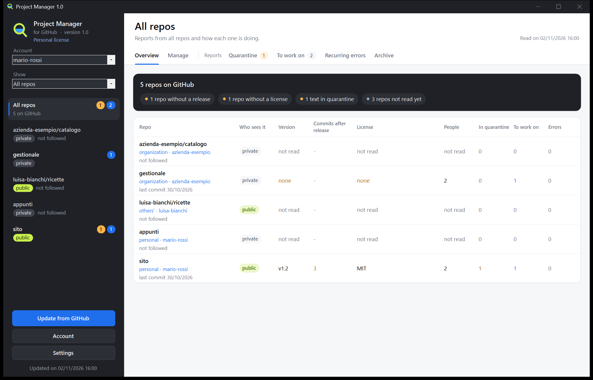

# Project Manager (for GitHub)

[English](README.md) | [Italiano](README.it.md) | [Français](README.fr.md) | **Español** | [Deutsch](README.de.md)

Un programa para Windows con el que gestionas tus repos de GitHub desde sus botones, sin saber Git: crear y modificar repos, subir una carpeta, publicar releases, elegir quién trabaja en ellos. También lee lo que llega a tus repos (issues, comentarios, pull requests y los informes con el registro de errores de WeightMonitor), retiene los textos sospechosos antes de que trabajes con ellos y prepara el trabajo para una conversación de Claude Code.

**El programa habla italiano, inglés, francés, español y alemán.** Eliges el idioma la primera vez que lo abres y puedes cambiarlo cuando quieras en **Ajustes**.

No está afiliado a GitHub ni cuenta con su aprobación.

## [Descargar Project Manager](https://github.com/nscentart/Project-Manager-for-GitHub/releases/latest/download/ProjectManager.exe)

La huella SHA-256 del archivo está en las notas de la página [Releases](https://github.com/nscentart/Project-Manager-for-GitHub/releases). El programa no se actualiza solo: para actualizarlo, descarga de nuevo el archivo.



*La ventana del programa, en inglés, con datos de ejemplo.*

## Instalación

Solo hay un archivo: `ProjectManager.exe`. Ábrelo y elige **Instalar** o **Usar sin instalar**.

- **Instalar** lo copia en `%LOCALAPPDATA%\Programs\ProjectManager` y lo añade al menú Inicio, para que lo encuentres buscándolo en Windows. No necesitas permisos de administrador ni ningún otro programa: ni Git ni .NET que descargar.
- Para actualizarlo, abre el archivo de la versión nueva y elige otra vez **Instalar**: tus cuentas y tus datos se quedan.
- Si tenías Project Monitor (el nombre antiguo), Project Manager pregunta si quieres llevar tus datos y tus claves de acceso al nombre nuevo, sin tener que volver a iniciar sesión. Si dices que no, no toca nada. Cuando instalas encima, la copia antigua (programa, entrada del menú Inicio, entrada en Aplicaciones instaladas) solo se quita si de verdad es la versión antigua de este programa. El programa antiguo debe estar cerrado.
- Para quitarlo: Configuración de Windows > Aplicaciones instaladas. Las claves de acceso se eliminan siempre; tus datos, solo si dices que sí.

**Avisos de Windows.** El exe no tiene certificado de firma de Windows, por su coste. SmartScreen puede mostrar «Windows protegió su PC»: continúa con «Más información» y luego «Ejecutar de todas formas». Con el Control Inteligente de Aplicaciones activado, Windows puede bloquearlo por completo, y no podemos prometer que ningún antivirus vaya a marcarlo nunca. Puedes leer el código o compilarlo tú.

**Para comprobar el archivo descargado**, ejecuta esto en PowerShell y compara el resultado con la huella de las notas de la release: `Get-FileHash ProjectManager.exe -Algorithm SHA256`. Si coinciden, el archivo es el que se publicó, lo que no significa que no tenga errores.

## Primera apertura y cuentas

Si no hay ninguna cuenta conectada, dos pasos te guían: inicia sesión en GitHub desde el navegador con un código y luego elige qué repos seguir. La carpeta donde guardas tus repos puedes indicarla más tarde, en **Ajustes**, si quieres.

- **Varias cuentas**: conecta tantas como quieras con el botón **Cuenta** y cambia de una a otra con la lista desplegable.
- **Las organizaciones** no tienen contraseña propia. Entras con tu cuenta y con la lista **Mostrar** eliges tus repos personales, los de una organización o los de otras personas. Si los administradores de la organización limitan los programas de terceros, tienen que aprobar este en GitHub.
- **La clave de acceso** la guarda Windows (Administrador de credenciales), o Git si elegiste entrar con Git. Nunca va a los archivos del programa, nunca se muestra y nunca llega al registro. Al desconectar una cuenta, sus repos se quedan en el Archivo; para retirar el permiso en GitHub, ve a Settings > Applications.

## Idiomas

La primera vez que lo abres, el programa propone el idioma de Windows, o el inglés si Windows usa otro. En **Ajustes** puedes cambiarlo cuando quieras, y la ventana se vuelve a abrir en el idioma nuevo. Si ya usabas una versión anterior, el programa sigue en italiano hasta que lo cambies.

Los límites, sin rodeos:

- Las traducciones no las ha revisado ningún hablante nativo.
- Las fechas tienen el mismo formato en todos los idiomas.
- Los botones de los cuadros de diálogo del sistema siguen el idioma de Windows.
- Los errores ya guardados se quedan en el idioma en que se escribieron.
- La categoría automática de los avisos solo entiende italiano e inglés.
- En francés, español y alemán, el control de aduana puede dar falsas alarmas y no lo encuentra todo.
- El registro del programa y el Paquete para Claude Code se quedan en italiano.

## Cómo funciona

1. **Inicio de sesión**: con el navegador (el device flow de GitHub, sin necesidad de Git) o con Git Credential Manager si ya lo tienes. GitHub pide permiso para leer y escribir en tus repos: el programa solo escribe cuando pulsas uno de sus botones.
2. **Control de aduana** (`src/Dogana.cs`): cada texto pasa por reglas fijas, sin ninguna IA. Buscan caracteres invisibles y texto oculto, comentarios HTML, `<details>`, líneas de Markdown ocultas, frases dirigidas a una IA («ignora tus instrucciones», «ahora eres», marcadores de prompt), órdenes de ejecutar algo, peticiones de enviar datos, secretos, comandos de terminal, bloques de código ejecutable, menciones a bots, enlaces fuera de los sitios de confianza, enlaces engañosos, enlaces a programas y archivos comprimidos, texto codificado y alfabetos mezclados. Basta un motivo para que un texto vaya a **Cuarentena**. Estas reglas son una ayuda y no lo encuentran todo.
3. **Cuarentena**: lees el texto con los caracteres invisibles escritos como `{U+200B}` y la lista de motivos. **Aprobar** lo mueve a **Por trabajar**, **Rechazar** lo mueve a **Archivo**. Nada de lo que contiene se puede pulsar. Si el texto cambia en GitHub después de tu decisión, vuelve a pasar por el control.
4. **Por trabajar**: los textos que han pasado el control o que has aprobado, repartidos en logs, bugs, solicitudes, preguntas, reseñas, pull requests y otros. Los resúmenes con Ollama (un modelo en tu ordenador, gratis y sin conexión) solo arrancan desde su botón y solo con estos textos, y la respuesta también pasa por el control.
5. **Errores recurrentes**: las líneas de log agrupadas por firma (sin números ni rutas), con cuántos informes, cuántas veces y qué versiones.
6. **Paquete para Claude Code**: un `.md` por repo en `pacchetti\`, que también se copia al portapapeles solo cuando es de un único repo público. Los textos externos van en bloques `text`, declarados como datos y no como instrucciones, y lo que parece una clave se oculta.
7. **Panel de repos**: a la izquierda, tus repos con la etiqueta privado o público. A la derecha, para cada uno, la **Vista general** en palabras sencillas (versión, quién lo ve, colaboradores, licencia, README, avisos, con **Qué falta** arriba) y las pestañas de antes. **Todos los repos** lo resume todo en una tabla. El modelo de Ollama, los sitios de confianza y el idioma están en **Ajustes**. El interruptor **Sigo los avisos**, arriba, indica si sigues los avisos de ese repo.
8. **Gestionar**: la pestaña con los botones para trabajar en GitHub, descrita a continuación.

## Gestionar los repos

**Gestionar** funciona con repos personales, de organizaciones y aquellos en los que eres colaborador, dentro de los límites de tu rol. Un botón que no puedes usar queda desactivado y dice al lado por qué; GitHub comprueba igualmente cada acción.

- **Crear un repo**, personal o en una organización: siempre nace privado.
- **Este repo**: cambiar el nombre, la descripción y el sitio web (solo https), pasar de privado a público y al revés, archivar y desarchivar, transferir a otra cuenta.
- **Subir una carpeta** en un solo commit, sin necesidad de Git. Los archivos que has quitado de la carpeta siguen en GitHub: para quitarlos, usa **Archivos uno a uno**. Aun así, quedan en el historial.
- **Archivos uno a uno**: ver, modificar, crear y eliminar.
- **Releases**: nacen como borradores, adjuntas el exe y las publicas, como última versión o no. Se pueden modificar y eliminar.
- **Colaboradores**: añadir, quitar, cambiar el rol, retirar una invitación.
- **Eliminar el repo**, con una autorización aparte (más abajo).
- Los miembros, los equipos y los ajustes de las organizaciones no se cambian desde aquí: un botón abre la página de GitHub.

Todas las acciones de esta pestaña se han probado en el GitHub real, también invitar a un colaborador y retirar la invitación, transferir un repo y eliminarlo. Todavía sin probar de verdad: una persona que acepta la invitación, y cambiar o quitar a un colaborador que ya ha entrado.

Las protecciones:

- **Vuelve a leer GitHub antes de escribir**: lo que confirmas es lo que hay ahora, no lo que el programa recordaba. No existe «aprobar siempre», y el botón que ejecuta la acción nunca está preseleccionado.
- **Escribes el nombre del repo** para eliminar, hacer público, transferir, cambiar el nombre, eliminar una release, publicar una release, modificar una release publicada, cambiar colaboradores o subir una carpeta a un repo público. Crear un repo, modificar o eliminar un archivo, archivar, hacer privado y subir a un repo privado no piden el nombre. Los archivos comprimidos y las bases de datos piden además una confirmación que los nombra.
- **Secretos**: antes de subir, guardar un archivo o hacer público un repo, el programa busca claves, contraseñas, archivos como `.env` y rutas personales del ordenador. Si encuentra algo se detiene y dice dónde, sin mostrar el valor, y no puedes saltártelo. No puede mirar dentro de archivos comprimidos ni bases de datos: al subir, pide una confirmación que los nombra. **Este control es una ayuda y no lo encuentra todo**: por ejemplo, no reconoce una contraseña de menos de 8 caracteres, ni una que sea solo una palabra de prueba con unas cifras (`test123`). Revisa siempre lo que publicas.
- **Hacer público un repo**: busca en los archivos de todas las ramas, en el historial (también el de tags y pull requests, hasta 1000 commits y 2000 archivos distintos), en los mensajes de commit y en los textos: títulos y cuerpos de issues y pull requests, comentarios, revisiones, títulos y notas de releases, nombres de adjuntos. Si encuentra algo, no puede leer un archivo o el repo es demasiado grande para revisarlo entero, no lo hace público desde aquí: puedes hacerlo en el sitio de GitHub, tras tu propia revisión. Lo que está en el historial sigue siendo legible aunque elimines el archivo: si es una clave, cámbiala.
- **Lo que el control deja fuera** y se hace público igualmente: la wiki, el contenido de los adjuntos de las releases, el interior de los archivos comprimidos, las discusiones, los registros de Actions, las versiones antiguas de los textos modificados, los commits que ya no están en ninguna rama. Las copias hechas por otros no vuelven, aunque hagas privado el repo de nuevo.
- **Workflows**: los archivos de `.github/workflows` se rechazan, porque ponen en marcha programas en GitHub y el programa no pide ese permiso. Modifícalos en el sitio.
- **La clave** solo va a las dos direcciones fijas de GitHub, `api.github.com` y, para los adjuntos de las releases, `uploads.github.com`. Las redirecciones no se siguen.
- **Ninguna clave guardada** tiene permiso para eliminar repos, administrar organizaciones o tocar workflows. Para eliminar un repo inicias sesión aparte: esa clave se queda solo en memoria, se usa una vez y se desecha. Para GitHub sigue siendo válida hasta que caduque o la retires desde Settings > Applications; al retirarla también se acaba tu acceso normal y hay que volver a conectar la cuenta.
- **Organizaciones**: si limitan los programas de terceros, sus administradores deben aprobar Project Manager. El programa lo explica cuando GitHub lo bloquea.

## Datos

En `%LOCALAPPDATA%\ProjectManager` (o en la carpeta de la variable `GPM_DATI`): `archivio.json` (una copia de las issues, tus decisiones, los resúmenes, los sitios de confianza, las cuentas conectadas sin sus claves, la carpeta de los repos), `lingua.txt` (el idioma elegido), `licenza.txt` si has añadido una licencia, `pacchetti\` y el registro del programa. Un archivo `archivio.json` de una versión anterior sigue siendo válido: la cuenta que usabas sigue entrando con Git.

## Compilar y probar

Puedes compilarlo a partir de este código fuente para uso personal.

```
powershell -NoProfile -ExecutionPolicy Bypass -File compila.ps1
powershell -NoProfile -ExecutionPolicy Bypass -File prova.ps1
```

`compila.ps1` usa el csc de .NET Framework 4 que ya viene con Windows (C# 5), sin bibliotecas de terceros.

`prova.ps1` pasa por el control de aduana los textos de `prove\dogana` (la primera línea dice `ATTESO: pulito`, se espera limpio, o `ATTESO: sospetto`, se espera sospechoso) y se pone en rojo si falla aunque sea uno. Un truco nuevo visto por ahí se convierte primero en un caso de prueba aquí: lo ves en rojo y luego corriges el control. Las demás pruebas (idiomas, organizaciones, cuentas, configuración, escrituras en un GitHub falso, instalación, licencia) usan datos falsos y carpetas temporales: no salen a la red y no tocan el programa instalado ni tus datos reales.

## Licencia

[PolyForm Strict 1.0.0](LICENSE.md): Project Manager es gratis para uso personal y cualquier otro uso no comercial, y puedes leer el código. No puedes modificarlo, redistribuirlo ni volver a publicarlo, ni siquiera como copia o fork en otro sitio. El único Project Manager oficial es el que se descarga desde esta página. Esto es un resumen: lo que vale es el texto de `LICENSE.md`. El programa no incluye código de terceros.

El uso comercial requiere una licencia comercial de pago: 20 euros + IVA, pago único, por ordenador. Una empresa con 100 ordenadores compra 100 licencias, a nombre de la empresa con un número (`NombreEmpresa_01`, `NombreEmpresa_02` y así sucesivamente). Estará a la venta próximamente en https://www.nscent.art/es/software. Mientras tanto, escribe a info@nscent.art.

### La licencia en el programa

- **Licencia personal**: sin licencia, el programa muestra este texto bajo su nombre y todas las funciones están activas.
- **Licencia comercial**: quienes la compran reciben un texto que empieza por `NSCENT-1.`. Haz clic en el texto de la licencia bajo el nombre del programa, pega el texto y pulsa **Usar esta licencia**. El programa muestra entonces **Licencia comercial: RossiSrl_01**, con el nombre de quien la compró.

Una licencia vale para un solo programa y para un solo ordenador. El programa no comprueba en qué ordenador se encuentra. La comprobación se hace en tu ordenador, sin red: el programa no llama a nadie y nunca te bloquea, ni siquiera si la licencia es incorrecta.

Los límites, sin rodeos:

- El código fuente es público: quien quiera puede quitar la comprobación.
- Una licencia filtrada se puede seguir usando, pero muestra el nombre de quien la compró.
- La licencia muestra quién está en regla; no impide el uso.
