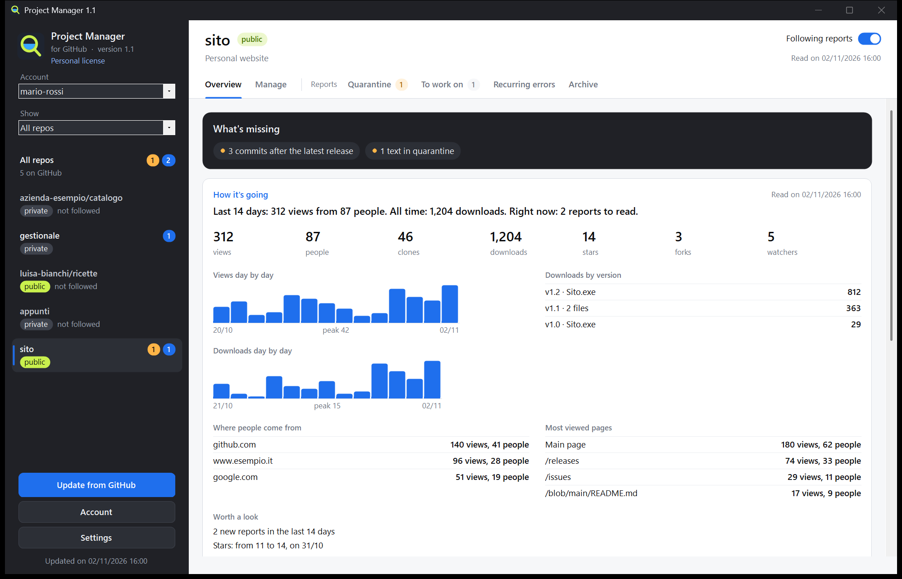

# Project Manager (for GitHub)

[English](README.md) | [Italiano](README.it.md) | **Français** | [Español](README.es.md) | [Deutsch](README.de.md)

Un programme Windows pour gérer vos repos GitHub depuis ses boutons, sans connaître Git : créer et modifier des repos, envoyer un dossier, publier des releases, choisir qui y travaille. Il lit aussi ce qui arrive sur vos repos (issues, commentaires, pull requests et rapports contenant le journal d'erreurs de WeightMonitor), retient les textes suspects avant que vous ne les traitiez et prépare le travail pour une conversation Claude Code. Et il montre comment ça se passe pour chaque repo : visites, téléchargements, d'où viennent les gens.

**Le programme parle italien, anglais, français, espagnol et allemand.** Vous choisissez la langue à la première ouverture et vous pouvez la changer à tout moment dans **Paramètres**.

Ni affilié à GitHub ni approuvé par GitHub.

[Site web et licence](https://www.nscent.art/fr/software)

## [Télécharger Project Manager](https://github.com/nscentart/Project-Manager-for-GitHub/releases/latest/download/ProjectManager.exe)

L'empreinte SHA-256 du fichier se trouve dans les notes de la page [Releases](https://github.com/nscentart/Project-Manager-for-GitHub/releases). Il ne se met jamais à jour tout seul : il vous prévient, et vous décidez.



*La fenêtre du programme, en anglais, avec des données d'exemple.*

## Installation

Il n'y a qu'un seul fichier : `ProjectManager.exe`. Ouvrez-le et choisissez **Installer** ou **Utiliser sans installer**.

- **Installer** le copie dans `%LOCALAPPDATA%\Programs\ProjectManager` et l'ajoute au menu Démarrer, pour que vous le trouviez en le cherchant dans Windows. Il ne faut ni droits d'administrateur ni autre programme : pas de Git, et pas de .NET à télécharger.
- Pour mettre à jour, ouvrez le fichier de la nouvelle version et choisissez de nouveau **Installer** : vos comptes et vos données restent.
- Si vous aviez Project Monitor (l'ancien nom), Project Manager demande s'il doit transférer vos données et vos clés d'accès vers le nouveau nom, sans que vous ayez à vous reconnecter. Si vous refusez, il ne touche à rien. Quand vous installez par-dessus, l'ancienne copie (programme, entrée du menu Démarrer, entrée dans Applications installées) n'est supprimée que s'il s'agit vraiment de l'ancienne version de ce programme. L'ancien programme doit être fermé.
- Pour le désinstaller : Paramètres de Windows > Applications installées. Les clés d'accès sont toujours supprimées, vos données seulement si vous répondez oui.

**Avertissements de Windows.** L'exe n'a pas de certificat de signature Windows, à cause de son coût. SmartScreen peut afficher « Windows a protégé votre ordinateur » : continuez avec « Informations complémentaires », puis « Exécuter quand même ». Si le Contrôle intelligent des applications est activé, Windows peut le bloquer entièrement, et nous ne pouvons pas promettre qu'aucun antivirus ne le signalera jamais. Vous pouvez lire le code ou le compiler vous-même.

## Mettre à jour

Project Manager ne télécharge et n'installe jamais rien tout seul. Il se contente de vérifier : 20 secondes après le démarrage, il demande une fois à GitHub, sans votre clé, s'il existe une version plus récente. Si c'est le cas, une fenêtre affiche la nouvelle version, la vôtre, l'empreinte SHA-256 du fichier (si celle du fichier et celle des notes ne correspondent pas, elle vous dit de ne pas l'utiliser) et les notes de la release, avec trois boutons : **Ignorer cette version**, **Plus tard** et **Ouvrir la page de la version**. Si GitHub ne répond pas, le programme ne vous dérange pas et écrit une ligne dans son journal.

**Ouvrir la page de la version** ouvre dans le navigateur sa page sur GitHub, où vous voyez ce qui a changé et la comparaison avec le code précédent. Quoi que dise la réponse de GitHub, le navigateur n'ouvre qu'une page du repo officiel. Pour mettre à jour :

1. Depuis cette page, téléchargez `ProjectManager.exe` dans un dossier neuf et vide.
2. Fermez Project Manager, ouvrez le fichier téléchargé et choisissez **Installer** : il prend la place de l'ancienne version et redémarre. Vos comptes et vos données restent. Si le programme est encore ouvert, le fichier vous demande de le fermer d'abord.

Si vous utilisez la copie sans installation, il suffit d'utiliser le nouvel exe à la place de l'ancien.

La vérification se désactive dans **Paramètres**, sous **Nouvelles versions**. **Vérifier maintenant**, au même endroit, répond toujours, même quand la vérification est désactivée ou pour une version ignorée. Quand elle est désactivée, la dernière version reste disponible au lien de téléchargement en haut de cette page.

## Comment vérifier le fichier

1. Téléchargez-le uniquement depuis cette page : c'est le seul Project Manager officiel.
2. Ouvrez PowerShell dans le dossier du fichier et tapez : `Get-FileHash .\ProjectManager.exe -Algorithm SHA256`
3. Le résultat doit être identique à l'empreinte SHA-256 écrite dans les notes de la release.

S'il est identique, vous avez le fichier que nous avons publié. Cela ne prouve pas qu'il est sans défaut : pour cela, il y a le code, que vous pouvez lire ici.

## Première ouverture et comptes

Si aucun compte n'est connecté, deux étapes vous guident : connectez-vous à GitHub depuis votre navigateur avec un code, puis choisissez les repos à suivre. Le dossier où vous gardez vos repos peut être indiqué plus tard, dans **Paramètres**, si vous le souhaitez.

- **Plusieurs comptes** : connectez-en autant que vous voulez avec le bouton **Compte** et passez de l'un à l'autre avec la liste déroulante.
- **Les organisations** n'ont pas de mot de passe propre. Vous vous connectez avec votre compte et, avec la liste **Afficher**, vous choisissez vos repos personnels, ceux d'une organisation ou ceux d'autres personnes. Si les administrateurs de l'organisation limitent les programmes tiers, ils doivent approuver celui-ci sur GitHub.
- **La clé d'accès** est conservée par Windows (Gestionnaire d'identification), ou par Git si vous avez choisi de vous connecter avec Git. Elle ne va jamais dans les fichiers du programme, n'est jamais affichée et n'arrive jamais dans le journal. Déconnecter un compte laisse ses repos dans les archives ; pour retirer l'autorisation sur GitHub, allez dans Settings > Applications.

## Langues

À la première ouverture, le programme propose la langue de Windows, ou l'anglais si Windows en utilise une autre. Dans **Paramètres**, vous pouvez la changer à tout moment, et la fenêtre se rouvre dans la nouvelle langue. Si vous utilisiez déjà une version précédente, le programme reste en italien jusqu'à ce que vous la changiez.

Les limites, sans détour :

- Les traductions n'ont pas été relues par un locuteur natif.
- Les dates ont le même format dans toutes les langues.
- Les boutons des boîtes de dialogue système de Windows suivent la langue de Windows.
- Les erreurs déjà enregistrées restent dans la langue où elles ont été écrites.
- La catégorie automatique des signalements ne comprend que l'italien et l'anglais.
- En français, en espagnol et en allemand, le contrôle de douane peut donner de fausses alertes et ne trouve pas tout.
- Le journal du programme et le Paquet pour Claude Code restent en italien.

## Fonctionnement

1. **Connexion** : par le navigateur (le device flow de GitHub, sans Git) ou par Git Credential Manager si vous l'avez déjà. GitHub demande l'autorisation de lire et d'écrire dans vos repos : le programme n'écrit que lorsque vous appuyez sur l'un de ses boutons.
2. **Contrôle de douane** (`src/Dogana.cs`) : chaque texte passe par des règles fixes, sans aucune IA. Elles cherchent les caractères invisibles et le texte caché, les commentaires HTML, `<details>`, les lignes Markdown cachées, les phrases destinées à une IA (« ignorez vos instructions », « vous êtes maintenant », marqueurs de prompt), les ordres d'exécuter quelque chose, les demandes d'envoi de données, les secrets, les commandes de terminal, les blocs de code exécutable, les mentions de bots, les liens hors des sites de confiance, les liens trompeurs, les liens vers des programmes et des archives, le texte encodé et les alphabets mélangés. Un seul motif suffit pour envoyer un texte en **Quarantaine**. Ces règles sont une aide et ne trouvent pas tout.
3. **Quarantaine** : vous lisez le texte avec les caractères invisibles écrits sous la forme `{U+200B}` et la liste des motifs. **Approuver** le déplace vers **À traiter**, **Refuser** le déplace vers **Archives**. Rien n'y est cliquable. Si le texte change sur GitHub après votre décision, il repasse par le contrôle.
4. **À traiter** : les textes qui ont passé le contrôle ou que vous avez approuvés, répartis en logs, bugs, demandes, questions, avis, pull requests et autres. Les résumés avec Ollama (un modèle sur votre ordinateur, gratuit et hors ligne) ne démarrent qu'avec leur bouton et seulement sur ces textes, et la réponse repasse elle aussi par le contrôle.
5. **Erreurs récurrentes** : les lignes de log regroupées par signature (chiffres et chemins retirés), avec le nombre de rapports, le nombre de fois et les versions concernées.
6. **Paquet pour Claude Code** : un `.md` par repo dans `pacchetti\`, copié aussi dans le presse-papiers uniquement s'il concerne un seul repo public. Les textes externes sont placés dans des blocs `text`, déclarés comme des données et non comme des instructions, et tout ce qui ressemble à une clé est masqué.
7. **Panneau des repos** : à gauche, vos repos avec l'étiquette privé ou public. À droite, pour chacun, la **Vue d'ensemble** en termes simples (version, qui le voit, collaborateurs, licence, README, signalements, avec **Ce qui manque** en tête) et les onglets ci-dessus. En haut de la **Vue d'ensemble** se trouve **Comment ça se passe**, décrit ci-dessous. **Tous les repos** résume tout dans un tableau. Le modèle Ollama, les sites de confiance et la langue se trouvent dans **Paramètres**. L'interrupteur **Suivre les signalements**, en haut, indique si vous suivez les signalements de ce repo.
8. **Gérer** : l'onglet avec les boutons pour travailler sur GitHub, décrit ci-dessous.

## Comment ça se passe

À chaque **Actualiser depuis GitHub**, pour chaque repo que votre clé peut lire, le programme lit les visites, les clones, d'où viennent les gens, les pages les plus vues, les téléchargements par version, les étoiles, les forks et les observateurs. **Tous les repos** les présente dans un tableau : Repo, Qui le voit, Version, Visites sur 14 jours, Téléchargements, Étoiles, Signalements à lire, Erreurs. Sur la page d'un repo, **Comment ça se passe** les résume en une phrase, avec les visites et les téléchargements jour par jour ; les cartes habituelles restent en dessous.

Si GitHub refuse l'un de ces chiffres (il ne montre le trafic qu'aux personnes qui peuvent écrire dans le repo), le programme indique « non disponible » et pourquoi : jamais un 0 pour un chiffre qu'il n'a pas lu. Une erreur sur ces chiffres n'arrête pas le reste de la lecture.

GitHub conserve le trafic pendant 14 jours. C'est pourquoi les visites, les visiteurs uniques, les clones et le total des téléchargements de chaque repo sont enregistrés jour par jour dans `storico.json`, sur cet ordinateur uniquement : les jours plus anciens restent là et nulle part ailleurs.

Les limites, dites clairement :

- GitHub dit combien de personnes sont passées, pas qui.
- Les chiffres arrivent avec quelques heures de retard.
- Les téléchargements depuis le site et depuis GitHub sont comptés ensemble et comprennent aussi les vôtres.
- « Personnes » est le total sur 14 jours donné par GitHub : les visiteurs uniques de chaque jour ne s'additionnent pas.
- GitHub ne donne que le total des téléchargements : le détail jour par jour commence à la première lecture du programme.

## Repos disparus

Un repo que GitHub ne liste plus passe dans un groupe fermé en bas, **Disparus (N)**, à gauche et dans le tableau : un clic l'ouvre. **Retirer de la liste**, sur sa page, le retire ; **Tout retirer**, dans le groupe, fait de même pour tous les repos disparus que vous voyez (ceux d'un autre compte restent). La confirmation indique que rien ne change sur GitHub et combien de textes téléchargés, de décisions et de jours d'historique cet ordinateur perd. Si un repo revient sur GitHub, il réapparaît tout seul à la prochaine actualisation.

## Gérer les repos

**Gérer** fonctionne sur les repos personnels, ceux des organisations et ceux où vous êtes collaborateur, dans les limites de votre rôle. Un bouton que vous ne pouvez pas utiliser reste désactivé et indique pourquoi à côté ; GitHub contrôle quand même chaque action.

- **Créer un repo**, personnel ou dans une organisation : il naît toujours privé.
- **Ce repo** : changer le nom, la description et le site (https uniquement), passer de privé à public et inversement, archiver et désarchiver, transférer à un autre compte.
- **Envoyer un dossier** en un seul commit, sans avoir besoin de Git. Les fichiers que vous avez retirés du dossier restent sur GitHub : pour les retirer, utilisez **Fichier par fichier**. Même ainsi, ils restent dans l'historique.
- **Fichier par fichier** : voir, modifier, créer et supprimer.
- **Release** : elles naissent sous forme de brouillon, vous joignez l'exe et vous les publiez, comme dernière version ou non. On peut les modifier et les supprimer.
- **Collaborateurs** : ajouter, retirer, changer le rôle, retirer une invitation.
- **Supprimer le repo**, avec une autorisation séparée (voir ci-dessous).
- Les membres, les équipes et les paramètres des organisations ne se changent pas d'ici : un bouton ouvre la page de GitHub.

Toutes les actions de cet onglet ont été essayées sur le vrai GitHub, y compris inviter un collaborateur et retirer l'invitation, transférer un repo et le supprimer. Pas encore essayé pour de vrai : une personne qui accepte l'invitation, et modifier ou retirer un collaborateur déjà présent.

Les protections :

- **Il relit GitHub avant d'écrire** : ce que vous confirmez est ce qui s'y trouve maintenant, pas ce dont le programme se souvenait. Il n'y a pas d'« approuver toujours », et le bouton qui exécute l'action n'est jamais présélectionné.
- **Vous tapez le nom du repo** pour supprimer, rendre public, transférer, renommer, supprimer une release, publier une release, modifier une release publiée, changer les collaborateurs ou envoyer un dossier dans un repo public. Créer un repo, modifier ou supprimer un fichier, archiver, rendre privé et envoyer dans un repo privé ne demandent pas le nom. Les archives et les bases de données demandent en plus une confirmation qui les nomme.
- **Secrets** : avant d'envoyer, d'enregistrer un fichier ou de rendre un repo public, le programme cherche des clés, des mots de passe, des fichiers comme `.env` et des chemins personnels de l'ordinateur. S'il trouve quelque chose, il s'arrête et dit où, sans montrer la valeur, et vous ne pouvez pas passer outre. Il ne peut pas regarder à l'intérieur des archives et des bases de données : à l'envoi, il demande une confirmation qui les nomme. **Ce contrôle est une aide et ne trouve pas tout** : par exemple, il ne reconnaît pas un mot de passe de moins de 8 caractères, ni un mot de passe qui n'est qu'un mot de test suivi de quelques chiffres (`test123`). Vérifiez toujours ce que vous publiez.
- **Rendre un repo public** : il cherche dans les fichiers de toutes les branches, dans l'historique (y compris celui des tags et des pull requests, jusqu'à 1000 commits et 2000 fichiers différents), dans les messages de commit et dans les textes : titres et corps des issues et des pull requests, commentaires, revues, titres et notes des releases, noms des pièces jointes. S'il trouve quelque chose, s'il ne peut pas lire un fichier ou si le repo est trop grand pour être contrôlé entièrement, il ne le rend pas public d'ici : vous pouvez le faire sur le site de GitHub, après votre propre contrôle. Ce qui se trouve dans l'historique reste lisible même si vous supprimez le fichier : si c'est une clé, changez-la.
- **Ce que le contrôle laisse de côté** et qui devient public quand même : le wiki, le contenu des pièces jointes des releases, l'intérieur des archives, les discussions, les journaux d'Actions, les anciennes versions des textes modifiés, les commits qui ne sont plus sur aucune branche. Les copies faites par d'autres ne reviennent pas, même si vous rendez de nouveau le repo privé.
- **Workflows** : les fichiers de `.github/workflows` sont refusés, car ils lancent des programmes sur GitHub et le programme ne demande pas cette autorisation. Modifiez-les sur le site.
- **La clé** ne va qu'aux deux adresses fixes de GitHub, `api.github.com` et, pour les pièces jointes des releases, `uploads.github.com`. Les redirections ne sont pas suivies.
- **Aucune clé enregistrée** n'a l'autorisation de supprimer des repos, d'administrer des organisations ou de toucher aux workflows. Pour supprimer un repo, vous vous connectez séparément : cette clé reste uniquement en mémoire, sert une fois puis est jetée. Pour GitHub, elle reste valable jusqu'à ce qu'elle expire ou que vous la retiriez depuis Settings > Applications ; la retirer met aussi fin à votre accès normal, et il faut reconnecter le compte.
- **Organisations** : si elles limitent les programmes tiers, leurs administrateurs doivent approuver Project Manager. Le programme l'explique quand GitHub le bloque.

## Données

Dans `%LOCALAPPDATA%\ProjectManager` (ou le dossier de la variable `GPM_DATI`) : `archivio.json` (une copie des issues, vos décisions, les résumés, les sites de confiance, les comptes connectés sans leurs clés, le dossier des repos), `lingua.txt` (la langue choisie), `storico.json` (les chiffres jour par jour : s'il est abîmé, le programme le met de côté et en commence un nouveau), `licenza.txt` si vous avez ajouté une licence, `pacchetti\` et le journal du programme. Une archive d'une version précédente reste valable : le compte que vous utilisiez continue à se connecter avec Git.

## Compiler et tester

Vous pouvez le compiler à partir de ce code source pour un usage personnel.

```
powershell -NoProfile -ExecutionPolicy Bypass -File compila.ps1
powershell -NoProfile -ExecutionPolicy Bypass -File prova.ps1
```

`compila.ps1` utilise le csc de .NET Framework 4 déjà présent dans Windows (C# 5), sans bibliothèque tierce.

`prova.ps1` fait passer les textes de `prove\dogana` par le contrôle de douane (la première ligne indique `ATTESO: pulito`, attendu propre, ou `ATTESO: sospetto`, attendu suspect) et passe au rouge si un seul se trompe. Une nouvelle astuce repérée quelque part devient d'abord un cas de test ici : vous le voyez passer au rouge, puis vous corrigez le contrôle. Les autres tests (langues, organisations, comptes, configuration, écritures sur un faux GitHub, installation, licence, chiffres, repos disparus, avis de nouvelle version, nouvel essai après la publication) utilisent de fausses données et des dossiers temporaires : ils restent hors ligne et ne touchent ni au programme installé ni à vos vraies données.

## Licence

[PolyForm Strict 1.0.0](LICENSE.md) : Project Manager est gratuit pour un usage personnel et pour tout autre usage non commercial, et vous pouvez lire le code. Vous ne pouvez pas le modifier, le redistribuer ni le republier, pas même sous forme de copie ou de fork sur un autre site. Le seul Project Manager officiel est celui qui se télécharge depuis cette page. Ceci est un résumé : seul le texte de `LICENSE.md` fait foi. Le programme ne contient aucun code tiers.

L'usage commercial exige une licence commerciale payante : 20 euros + TVA, paiement unique, par ordinateur. Une entreprise de 100 ordinateurs achète 100 licences, établies au nom de l'entreprise avec un numéro (`NomEntreprise_01`, `NomEntreprise_02`, et ainsi de suite). Elle sera bientôt en vente sur https://www.nscent.art/fr/software. En attendant, écrivez à info@nscent.art.

### La licence dans le programme

- **Licence personnelle** : sans licence, le programme affiche cette mention sous son nom et toutes les fonctions sont actives.
- **Licence commerciale** : les acheteurs reçoivent un texte qui commence par `NSCENT-1.`. Cliquez sur la mention de licence sous le nom du programme, collez le texte et appuyez sur **Utiliser cette licence**. Le programme affiche alors **Licence commerciale : RossiSrl_01**, avec le nom de l'acheteur.

Une licence n'est valable que pour un seul programme et pour un seul ordinateur. Le programme ne vérifie pas sur quel ordinateur il se trouve. Le contrôle se fait sur votre ordinateur, sans réseau : le programme n'appelle personne et ne vous bloque jamais, même si la licence est erronée.

Les limites, sans détour :

- Le code source est public : qui le veut peut retirer le contrôle.
- Une licence divulguée reste utilisable, mais elle affiche le nom de son acheteur.
- La licence montre qui est en règle ; elle n'empêche pas l'utilisation.
