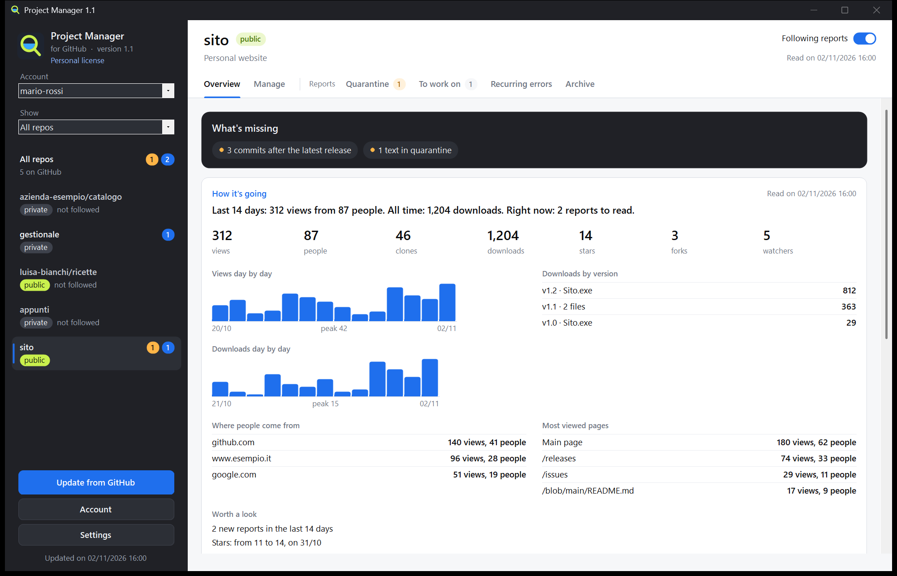

# Project Manager (for GitHub)

[English](README.md) | **Italiano** | [Français](README.fr.md) | [Español](README.es.md) | [Deutsch](README.de.md)

Un programma per Windows con cui gestisci le tue repo GitHub dai suoi tasti, senza conoscere Git: crei e modifichi le repo, carichi una cartella, pubblichi le release, scegli chi ci lavora. Legge anche quello che arriva sulle tue repo (issue, commenti, pull request e i rapporti col log degli errori di WeightMonitor), trattiene i testi sospetti prima che tu ci lavori e prepara il lavoro per una chat di Claude Code. E ti mostra come sta andando ogni repo: visite, download, da dove arriva la gente.

**Il programma parla italiano, inglese, francese, spagnolo e tedesco.** Scegli la lingua la prima volta che lo apri e la cambi quando vuoi in **Impostazioni**.

Non è affiliato a GitHub né approvato da GitHub.

[Sito e licenza](https://www.nscent.art/software)

## [Scarica Project Manager](https://github.com/nscentart/Project-Manager-for-GitHub/releases/latest/download/ProjectManager.exe)

L'impronta SHA-256 del file sta nelle note della pagina [Releases](https://github.com/nscentart/Project-Manager-for-GitHub/releases). Non si aggiorna mai da solo: ti avvisa, e decidi tu.



*La finestra del programma, in inglese, con dati d'esempio.*

## Installazione

C'è un file solo: `ProjectManager.exe`. Aprilo e scegli **Installa** o **Usa senza installare**.

- **Installa** lo copia in `%LOCALAPPDATA%\Programs\ProjectManager` e lo aggiunge al menu Start, così lo trovi cercandolo in Windows. Non servono permessi di amministratore né altri programmi: niente Git e nessun .NET da scaricare.
- Per aggiornarlo, apri il file della versione nuova e scegli di nuovo **Installa**: account e dati restano.
- Se avevi Project Monitor (il vecchio nome), Project Manager chiede se portare dati e chiavi d'accesso al nome nuovo, senza dover rifare l'accesso. Se dici no, non tocca niente. Quando installi sopra, la vecchia copia (programma, voce nel menu Start, voce in App installate) si toglie solo se è davvero la vecchia versione di questo programma. Il vecchio programma deve essere chiuso.
- Per toglierlo: Impostazioni di Windows > App installate. Le chiavi d'accesso si cancellano sempre, i dati solo se dici sì.

**Avvisi di Windows.** L'exe non ha un certificato di firma per Windows, per via del costo. SmartScreen può mostrare «Windows ha protetto il PC»: si prosegue con «Ulteriori informazioni», poi «Esegui comunque». Con Smart App Control attivo, Windows può bloccarlo del tutto, e non possiamo promettere che nessun antivirus lo segnalerà mai. Puoi leggere il codice o compilarlo tu.

## Aggiornare

Project Manager non scarica e non installa mai niente da solo. Controlla soltanto: 20 secondi dopo l'avvio chiede una volta a GitHub, senza la tua chiave, se c'è una versione più nuova. Se c'è, una finestra mostra la versione nuova, la tua, l'impronta SHA-256 del file (se quella del file e quella delle note non coincidono, ti dice di non usarlo) e le note della release, con tre tasti: **Salta questa versione**, **Più tardi** e **Apri la pagina della versione**. Se GitHub non risponde, il programma non ti dà fastidio e scrive una riga nel log.

**Apri la pagina della versione** apre nel browser la sua pagina su GitHub, dove vedi cosa è cambiato e il confronto col codice di prima. Qualunque cosa dica la risposta di GitHub, nel browser si apre solo una pagina della repo ufficiale. Per aggiornare:

1. Da quella pagina scarica `ProjectManager.exe`, in una cartella nuova e vuota.
2. Chiudi Project Manager, apri il file scaricato e scegli **Installa**: prende il posto della versione vecchia e riparte. Account e dati restano. Se il programma è ancora aperto, il file ti dice di chiuderlo prima.

Se usi la copia senza installazione, basta usare l'exe nuovo al posto del vecchio.

Il controllo si spegne da **Impostazioni**, alla voce **Nuove versioni**. **Controlla ora**, nello stesso punto, risponde sempre, anche a controllo spento o per una versione saltata. A controllo spento, l'ultima versione è comunque al link di download in cima a questa pagina.

## Come verificare il file

1. Scaricalo solo da questa pagina: è l'unico Project Manager ufficiale.
2. Apri PowerShell nella cartella del file e scrivi: `Get-FileHash .\ProjectManager.exe -Algorithm SHA256`
3. Il risultato deve essere identico all'impronta SHA-256 scritta nelle note della release.

Se è identica, hai il file che abbiamo pubblicato. Questo non prova che sia privo di difetti: per quello c'è il codice, che puoi leggere qui.

## Prima apertura e account

Se non c'è un account collegato, due passi ti guidano: accedi a GitHub dal browser con un codice, poi scegli quali repo seguire. La cartella in cui tieni le repo puoi indicarla dopo, in **Impostazioni**, se vuoi.

- **Più account**: ne colleghi quanti vuoi col tasto **Account** e passi dall'uno all'altro con l'elenco a discesa.
- **Le organizzazioni** non hanno una password propria. Entri col tuo account e con l'elenco **Mostra** scegli le tue repo personali, quelle di un'organizzazione o quelle di altre persone. Se gli amministratori dell'organizzazione limitano i programmi di terzi, devono approvare questo su GitHub.
- **La chiave d'accesso** la custodisce Windows (Gestione credenziali), oppure Git se hai scelto di entrare con Git. Non finisce mai nei file del programma, non si mostra e non arriva nel log. Scollegando un account, le sue repo restano nell'archivio; il permesso su GitHub si toglie da Settings > Applications.

## Lingue

La prima volta che lo apri, il programma propone la lingua di Windows, o l'inglese se Windows ne usa un'altra. In **Impostazioni** la cambi quando vuoi, e la finestra si riapre nella lingua nuova. Se usavi già una versione precedente, il programma resta in italiano finché non la cambi.

I limiti, detti chiaramente:

- Le traduzioni non sono state rilette da un madrelingua.
- Le date hanno lo stesso formato in tutte le lingue.
- I tasti delle finestre di sistema di Windows seguono la lingua di Windows.
- Gli errori già salvati restano nella lingua in cui sono stati scritti.
- La categoria automatica delle segnalazioni capisce solo italiano e inglese.
- In francese, spagnolo e tedesco la dogana può dare falsi allarmi e non trova tutto.
- Il log del programma e il Pacchetto per Claude Code restano in italiano.

## Come funziona

1. **Accesso**: dal browser (il device flow di GitHub, Git non serve) oppure con Git Credential Manager, se ce l'hai già. GitHub chiede il permesso di leggere e scrivere le tue repo: il programma scrive solo quando premi uno dei suoi tasti.
2. **Dogana** (`src/Dogana.cs`): ogni testo passa da regole fisse, senza AI. Cercano caratteri invisibili e testo nascosto, commenti HTML, `<details>`, righe Markdown nascoste, frasi rivolte a un'AI («ignora le istruzioni», «sei ora», marcatori da prompt), ordini di eseguire, richieste di mandare dati, segreti, comandi da terminale, blocchi di codice eseguibile, menzioni a bot, link fuori dai siti fidati, link ingannevoli, link a programmi e archivi, testo codificato e alfabeti mescolati. Basta un motivo e il testo va in **Quarantena**. Queste regole sono un aiuto e non trovano tutto.
3. **Quarantena**: leggi il testo con gli invisibili scritti come `{U+200B}` e i motivi elencati. **Approva** lo sposta in **Da lavorare**, **Rifiuta** lo sposta in **Archivio**. Niente è cliccabile. Se il testo cambia su GitHub dopo la tua decisione, ripassa dalla dogana.
4. **Da lavorare**: i testi passati dalla dogana o approvati da te, divisi in log, bug, richieste, domande, recensioni, pull request e altro. I riassunti con Ollama (un modello sul tuo computer, gratis e senza rete) partono solo dal loro tasto e solo su questi testi, e anche la risposta ripassa dalla dogana.
5. **Errori ricorrenti**: le righe dei log raggruppate per firma (numeri e percorsi tolti), con quanti rapporti, quante volte e quali versioni.
6. **Pacchetto per Claude Code**: un `.md` per repo in `pacchetti\`, copiato anche negli appunti solo quando è per una sola repo pubblica. I testi esterni stanno in blocchi `text`, dichiarati come dati e non come istruzioni, e ciò che sembra una chiave viene coperto.
7. **Pannello delle repo**: a sinistra le tue repo con l'etichetta privata o pubblica. A destra, per ognuna, la **Panoramica** in parole semplici (versione, chi la vede, collaboratori, licenza, README, segnalazioni, con **Cosa manca** in testa) e le schede qui sopra. In cima alla **Panoramica** c'è **Come sta andando**, descritto qui sotto. **Tutte le repo** riassume tutto in una tabella. Il modello di Ollama, i siti fidati e la lingua stanno in **Impostazioni**. L'interruttore **Seguo le segnalazioni** in alto dice se segui le segnalazioni di quella repo.
8. **Gestisci**: la scheda coi tasti per lavorare su GitHub, descritta qui sotto.

## Come sta andando

A ogni **Aggiorna da GitHub**, per ogni repo che la tua chiave può leggere, il programma legge visite, cloni, da dove arriva la gente, le pagine più viste, i download per versione, stelle, copie e osservatori. **Tutte le repo** li mette in una tabella: Repo, Chi la vede, Versione, Visite 14 giorni, Download, Stelle, Segnalazioni da leggere, Errori. Nella pagina di una repo, **Come sta andando** li riassume in una frase, con visite e download giorno per giorno; sotto restano le schede di sempre.

Se GitHub rifiuta uno di questi numeri (il traffico lo mostra solo a chi può scrivere nella repo), il programma dice «non disponibile» e il perché: mai uno 0 per un numero che non ha letto. Un errore su questi numeri non ferma il resto della lettura.

GitHub tiene il traffico per 14 giorni. Per questo visite, visitatori unici, cloni e totale dei download di ogni repo si salvano giorno per giorno in `storico.json`, solo su questo computer: i giorni più vecchi restano lì e da nessun'altra parte.

I limiti, detti chiaramente:

- GitHub dice quanti sono passati, non chi.
- I numeri arrivano con qualche ora di ritardo.
- I download dal sito e da GitHub si contano insieme e comprendono anche i tuoi.
- «Persone» è il totale dei 14 giorni dato da GitHub: i visitatori unici dei singoli giorni non si possono sommare.
- GitHub dà solo il totale dei download: quelli giorno per giorno partono da quando il programma lo legge la prima volta.

## Repo sparite

Una repo che GitHub non elenca più passa in un gruppo chiuso in fondo, **Sparite (N)**, a sinistra e in tabella: si apre con un clic. **Togli dall'elenco**, nella sua pagina, la toglie; **Togli tutte**, nel gruppo, fa lo stesso con tutte le sparite che vedi (quelle di un altro account restano). La conferma dice che su GitHub non cambia niente e quanti testi scaricati, decisioni e giorni di storico si perdono su questo computer. Se una repo torna su GitHub, al prossimo aggiornamento torna da sola.

## Gestire le repo

**Gestisci** lavora sulle repo personali, su quelle delle organizzazioni e su quelle in cui sei collaboratore, nei limiti del tuo ruolo. Un tasto che non puoi usare resta spento e dice accanto perché; GitHub controlla comunque ogni azione.

- **Crea una repo**, personale o in un'organizzazione: nasce sempre privata.
- **Questa repo**: cambi nome, descrizione e sito (solo https), passi tra privata e pubblica, archivi e togli dall'archivio, trasferisci a un altro account.
- **Carica una cartella** in un solo commit, senza bisogno di Git. I file che hai tolto dalla cartella restano su GitHub: per toglierli usa **File uno per uno**. Anche così restano nella storia.
- **File uno per uno**: vedi, modifichi, crei e cancelli.
- **Release**: nascono come bozze, alleghi l'exe e le pubblichi, come ultima versione o no. Si possono modificare e cancellare.
- **Collaboratori**: aggiungi, togli, cambi ruolo, ritiri un invito.
- **Cancella la repo**, con un'autorizzazione a parte (vedi sotto).
- Membri, team e impostazioni delle organizzazioni non si cambiano da qui: un tasto apre la pagina di GitHub.

Tutte le azioni di questa scheda sono state provate sul GitHub vero, anche invitare un collaboratore e ritirare l'invito, trasferire una repo e cancellarla. Non ancora provati dal vero: una persona che accetta l'invito, e cambiare o togliere un collaboratore già entrato.

Le protezioni:

- **Rilegge da GitHub prima di scrivere**: quello che confermi è ciò che c'è adesso, non ciò che il programma ricordava. Non esiste «approva sempre», e il tasto che esegue l'azione non è mai preselezionato.
- **Scrivi il nome della repo** per cancellare, rendere pubblica, trasferire, cambiare nome, cancellare una release, pubblicare una release, modificare una release pubblicata, cambiare i collaboratori o caricare una cartella in una repo pubblica. Creare una repo, modificare o cancellare un file, archiviare, rendere privata e caricare in una repo privata non chiedono il nome. Archivi e basi di dati vogliono anche una conferma che li nomina.
- **Segreti**: prima di caricare, salvare un file o rendere pubblica una repo, il programma cerca chiavi, password, file come `.env` e percorsi personali del computer. Se trova qualcosa si ferma e dice dove, senza mostrare il valore, e non puoi scavalcarlo. Dentro archivi e basi di dati non può guardare: al caricamento chiede una conferma che li nomina. **Questo controllo è un aiuto e non trova tutto**: per esempio non riconosce una password più corta di 8 caratteri, o una che è solo una parola di prova con qualche cifra (`test123`). Controlla sempre quello che pubblichi.
- **Rendere pubblica una repo**: cerca nei file di tutti i rami, nella storia (anche quella di tag e pull request, fino a 1000 commit e 2000 file diversi), nei messaggi dei commit e nei testi: titoli e corpi di issue e pull request, commenti, recensioni, titoli e note delle release, nomi degli allegati. Se trova qualcosa, non riesce a leggere un file o la repo è troppo grande per controllarla tutta, non la rende pubblica da qui: puoi farlo dal sito di GitHub, dopo un tuo controllo. Ciò che sta nella storia resta leggibile anche se cancelli il file: se è una chiave, cambiala.
- **Cosa resta fuori dal controllo** e diventa pubblico lo stesso: la wiki, il contenuto degli allegati delle release, l'interno degli archivi, le discussioni, i log di Actions, le vecchie versioni dei testi modificati, i commit che non stanno più in nessun ramo. Le copie fatte da altri non tornano indietro, anche se rendi di nuovo privata la repo.
- **Workflow**: i file in `.github/workflows` vengono rifiutati, perché fanno partire programmi su GitHub e il programma non chiede quel permesso. Modificali dal sito.
- **La chiave** va solo ai due indirizzi fissi di GitHub, `api.github.com` e, per gli allegati delle release, `uploads.github.com`. I rimandi non si seguono.
- **Nessuna chiave salvata** ha il permesso di cancellare repo, amministrare organizzazioni o toccare i workflow. Per cancellare una repo entri a parte: quella chiave sta solo in memoria, si usa una volta e si butta. Per GitHub resta valida finché non scade o non la ritiri da Settings > Applications; ritirandola decade anche il tuo accesso normale e l'account va ricollegato.
- **Organizzazioni**: se limitano i programmi di terzi, i loro amministratori devono approvare Project Manager. Il programma lo spiega quando GitHub lo blocca.

## Dati

In `%LOCALAPPDATA%\ProjectManager` (o nella cartella della variabile `GPM_DATI`): `archivio.json` (copia delle issue, le tue decisioni, riassunti, siti fidati, account collegati senza le chiavi, la cartella delle repo), `lingua.txt` (la lingua scelta), `storico.json` (i numeri giorno per giorno: se si rovina, il programma lo mette da parte e ne inizia uno nuovo), `licenza.txt` se hai aggiunto una licenza, `pacchetti\` e il log del programma. Un archivio di una versione precedente resta valido: l'account che usavi continua a entrare con Git.

## Compilare e provare

Puoi compilarlo da questo sorgente per uso personale.

```
powershell -NoProfile -ExecutionPolicy Bypass -File compila.ps1
powershell -NoProfile -ExecutionPolicy Bypass -File prova.ps1
```

`compila.ps1` usa il csc del .NET Framework 4 che c'è già in Windows (C# 5), senza librerie di terzi.

`prova.ps1` fa passare dalla dogana i testi di `prove\dogana` (la prima riga dice `ATTESO: pulito` oppure `ATTESO: sospetto`) ed è rosso se anche uno solo sbaglia. Un nuovo trucco visto in giro diventa prima un caso qui: lo vedi rosso, poi ripari il controllo. Le altre prove (lingue, organizzazioni, account, prima configurazione, scritture su un GitHub finto, installazione, licenza, numeri, repo sparite, avviso di versione nuova, riprova dopo la pubblicazione) usano dati finti e cartelle temporanee: restano fuori dalla rete e non toccano il programma installato né i tuoi dati veri.

## Licenza

[PolyForm Strict 1.0.0](LICENSE.md): Project Manager è gratis per uso personale e per ogni altro uso non commerciale, e il codice si può leggere. Non puoi modificarlo, ridistribuirlo o ripubblicarlo, nemmeno come copia o fork su un altro sito. L'unico Project Manager ufficiale è quello scaricato da questa pagina. Questo è un riassunto: fa fede il testo in `LICENSE.md`. Il programma non contiene codice di terzi.

L'uso commerciale richiede una licenza commerciale a pagamento: 20 euro + IVA, una tantum, per computer. Un'azienda con 100 computer compra 100 licenze, intestate al nome dell'azienda con un numero (`NomeAzienda_01`, `NomeAzienda_02` e così via). Sarà presto in vendita su https://www.nscent.art/software. Nel frattempo scrivi a info@nscent.art.

### La licenza nel programma

- **Licenza personale**: senza licenza, il programma mostra questa scritta sotto il suo nome e ogni funzione è attiva.
- **Licenza commerciale**: chi la compra riceve un testo che inizia con `NSCENT-1.`. Fai clic sulla scritta della licenza sotto il nome del programma, incolla il testo e premi **Usa questa licenza**. Il programma poi mostra **Licenza commerciale: RossiSrl_01**, col nome di chi l'ha comprata.

Una licenza vale per un solo programma e per un solo computer. Il programma non controlla su quale computer si trova. Il controllo avviene sul tuo computer, senza rete: il programma non chiama nessuno e non ti blocca mai, nemmeno se la licenza è sbagliata.

I limiti, detti chiaramente:

- Il sorgente è pubblico: chi vuole può togliere il controllo.
- Una licenza finita in giro si può comunque usare, ma mostra il nome di chi l'ha comprata.
- La licenza dice chi è in regola; non impedisce l'uso.
