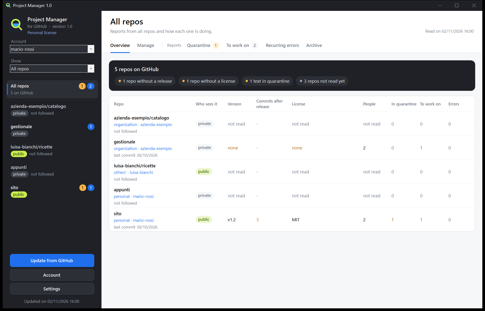

# Project Manager (for GitHub)

**English** | [Italiano](README.it.md) | [Français](README.fr.md) | [Español](README.es.md) | [Deutsch](README.de.md)

A Windows program for managing your GitHub repos from its buttons, without knowing Git: create and change repos, upload a folder, publish releases, choose who works on them. It also reads what arrives on your repos (issues, comments, pull requests and the error-log reports from WeightMonitor), holds back suspicious text before you act on it, and prepares the work for a Claude Code chat.

**The program speaks Italian, English, French, Spanish and German.** You choose the language the first time you open it and can change it at any time in **Settings**.

Not affiliated with or endorsed by GitHub.

## [Download Project Manager](https://github.com/nscentart/Project-Manager-for-GitHub/releases/latest/download/ProjectManager.exe)

The SHA-256 fingerprint of the file is in the notes on the [Releases](https://github.com/nscentart/Project-Manager-for-GitHub/releases) page. The program does not update itself: to update it, download the file again.



*The program window, in English, with example data.*

## Install

There is only one file: `ProjectManager.exe`. Open it and choose **Install** or **Use without installing**.

- **Install** copies it to `%LOCALAPPDATA%\Programs\ProjectManager` and adds it to the Start menu, so you can find it by searching in Windows. You don't need administrator rights or any other program: no Git, and no .NET to download.
- To update, open the file of the new version and choose **Install** again: your accounts and data stay.
- If you had Project Monitor (the old name), Project Manager asks whether to bring your data and access keys over to the new name, with no need to sign in again. If you say no, it touches nothing. When you install over it, the old copy (program, Start menu entry, entry in Installed apps) is removed only if it really is the old version of this program. The old program must be closed.
- To remove it: Windows Settings > Installed apps. Access keys are always deleted; your data only if you say yes.

**Windows warnings.** The exe has no Windows code-signing certificate, because of the cost. SmartScreen may show "Windows protected your PC": continue with "More info", then "Run anyway". With Smart App Control turned on, Windows may block it entirely, and we cannot promise that no antivirus will ever flag it. You can read the code or compile it yourself.

**To check the downloaded file**, run this in PowerShell and compare the result with the fingerprint in the release notes: `Get-FileHash ProjectManager.exe -Algorithm SHA256`. A match tells you the file is the one that was published, not that it is free of bugs.

## First start and accounts

If no account is connected, two steps guide you through setup: sign in to GitHub from your browser with a code, then choose which repos to follow. You can point it to the folder where you keep your repos later, in **Settings**, if you want to.

- **Several accounts**: connect as many as you like with the **Account** button, and switch between them from the drop-down list.
- **Organizations** have no password of their own. You sign in with your account and use the **Show** list to choose your personal repos, those of an organization or those of other people. If the organization's administrators restrict third-party programs, they need to approve this one on GitHub.
- **The access key** is kept by Windows (Credential Manager), or by Git if you chose to sign in through Git. It never goes into the program's files, is never shown and never reaches the log. Disconnecting an account leaves its repos in the archive; to withdraw the permission on GitHub, go to Settings > Applications.

## Languages

The first time you open the program it suggests the language of Windows, or English if Windows uses another one. In **Settings** you can change it at any time, and the window reopens in the new language. If you already used an earlier version, the program stays in Italian until you change it.

The limits, stated plainly:

- The translations have not been reviewed by a native speaker.
- Dates have the same format in every language.
- Buttons in Windows system dialogs follow the language of Windows.
- Errors already saved stay in the language they were written in.
- The automatic category of reports understands only Italian and English.
- In French, Spanish and German the customs check can raise false alarms and does not catch everything.
- The program's log and the Package for Claude Code stay in Italian.

## How it works

1. **Sign-in**: through the browser (GitHub's device flow, no Git needed) or through Git Credential Manager if you already have it. GitHub asks for permission to read and write your repos: the program writes only when you press one of its buttons.
2. **Customs check** (`src/Dogana.cs`): every text goes through fixed rules, with no AI involved. They look for invisible characters and hidden text, HTML comments, `<details>`, hidden Markdown lines, sentences aimed at an AI ("ignore your instructions", "you are now", prompt markers), orders to run something, requests to send data, secrets, terminal commands, blocks of executable code, bot mentions, links outside the trusted sites, misleading links, links to programs and archives, encoded text and mixed alphabets. One reason is enough to send a text to **Quarantine**. These rules are an aid and do not catch everything.
3. **Quarantine**: you read the text with invisible characters written out as `{U+200B}` and the reasons listed. **Approve** moves it to **To work on**, **Reject** moves it to **Archive**. Nothing in it is clickable. If the text changes on GitHub after your decision, it goes through the check again.
4. **To work on**: texts that passed the check or that you approved, sorted into logs, bugs, requests, questions, reviews, pull requests and others. Summaries with Ollama (a model on your own computer, free and offline) start only from their button and only on these texts, and the answer goes through the check too.
5. **Recurring errors**: log lines grouped by signature (numbers and paths removed), showing how many reports, how many times and which versions.
6. **Package for Claude Code**: one `.md` per repo in `pacchetti\`, also copied to the clipboard only when it is for a single public repo. External texts sit in `text` blocks, declared as data and not as instructions, and anything that looks like a key is masked.
7. **Repo panel**: on the left, your repos labelled private or public. On the right, for each one, **Overview** in plain words (version, who can see it, collaborators, license, README, reports, with **What's missing** at the top) and the tabs above. **All repos** sums everything up in a table. The Ollama model, the trusted sites and the language are in **Settings**. The **Following reports** switch at the top shows whether you follow the reports of that repo.
8. **Manage**: the tab with the buttons for working on GitHub, described below.

## Managing repos

**Manage** works on personal repos, organization repos and repos where you are a collaborator, within the limits of your role. A button you can't use stays off and says why next to it; GitHub still checks every action.

- **Create a repo**, personal or in an organization: it always starts out private.
- **This repo**: change the name, description and website (https only), switch between private and public, archive and unarchive, transfer to another account.
- **Upload a folder** in a single commit, with no Git needed. Files you removed from the folder stay on GitHub: to remove them, use **Single files**. Even then they stay in the history.
- **Single files**: view, edit, create and delete.
- **Releases**: they start as drafts, you attach the exe and publish them, as the latest version or not. They can be edited and deleted.
- **Collaborators**: add, remove, change role, withdraw an invitation.
- **Delete the repo**, with a separate authorization (see below).
- Organization members, teams and settings can't be changed from here: a button opens the GitHub page.

All the actions on this tab have been tried on real GitHub, including inviting a collaborator and withdrawing the invitation, transferring a repo and deleting it. Not yet tried for real: a person accepting an invitation, and changing or removing a collaborator who has already joined.

The safeguards:

- **It rereads from GitHub before writing**: what you confirm is what is there now, not what the program remembered. There is no "always approve", and the button that carries out the action is never preselected.
- **You type the repo's name** to delete, make public, transfer, rename, delete a release, publish a release, edit a published release, change collaborators or upload a folder to a public repo. Creating a repo, editing or deleting a file, archiving, making a repo private and uploading to a private repo don't ask for the name. Archives and databases also need a confirmation that names them.
- **Secrets**: before uploading, saving a file or making a repo public, the program looks for keys, passwords, files such as `.env` and personal computer paths. If it finds something it stops and says where, without showing the value, and you can't override it. It can't look inside archives and databases: when uploading, it asks for a confirmation that names them. **This check is an aid and does not find everything**: for example, it won't recognize a password shorter than 8 characters, or one that is just a test word with a few digits (`test123`). Always check what you publish.
- **Making a repo public**: it searches the files on all branches, the history (including that of tags and pull requests, up to 1000 commits and 2000 different files), commit messages and texts: titles and bodies of issues and pull requests, comments, reviews, release titles and notes, attachment names. If it finds something, can't read a file, or the repo is too large to check completely, it won't make the repo public from here: you can do that on the GitHub site, after your own check. Whatever is in the history stays readable even if you delete the file: if it is a key, change it.
- **What the check leaves out** and still becomes public: the wiki, the contents of release attachments, the inside of archives, discussions, Actions logs, old versions of edited texts, commits no longer on any branch. Copies made by others don't come back, even if you make the repo private again.
- **Workflows**: files in `.github/workflows` are refused, because they start programs on GitHub and the program does not ask for that permission. Edit them on the site.
- **The key** goes only to GitHub's two fixed addresses, `api.github.com` and, for release attachments, `uploads.github.com`. Redirects are not followed.
- **No saved key** has permission to delete repos, administer organizations or touch workflows. To delete a repo you sign in separately: that key stays in memory only, is used once and thrown away. GitHub still considers it valid until it expires or you withdraw it from Settings > Applications; withdrawing it also ends your normal access, and the account has to be connected again.
- **Organizations**: if they restrict third-party programs, their administrators must approve Project Manager. The program explains this when GitHub blocks it.

## Data

In `%LOCALAPPDATA%\ProjectManager` (or the folder in the `GPM_DATI` variable): `archivio.json` (a copy of the issues, your decisions, summaries, trusted sites, connected accounts without their keys, the repos folder), `lingua.txt` (the language you chose), `licenza.txt` if you added a license, `pacchetti\` and the program's log. An archive from an earlier version stays valid: the account you used before keeps using Git's sign-in.

## Build and test

You can compile it from this source for personal use.

```
powershell -NoProfile -ExecutionPolicy Bypass -File compila.ps1
powershell -NoProfile -ExecutionPolicy Bypass -File prova.ps1
```

`compila.ps1` uses the .NET Framework 4 csc that already comes with Windows (C# 5), with no third-party libraries.

`prova.ps1` runs the texts in `prove\dogana` through the customs check (the first line says `ATTESO: pulito`, expected clean, or `ATTESO: sospetto`, expected suspicious) and turns red if even one is wrong. A new trick seen in the wild gets a test case here first: you watch it go red, then fix the check. The other tests (languages, organizations, accounts, setup, writes to a fake GitHub, installation, license) use fake data and temporary folders: they stay off the network and leave the installed program and your real data alone.

## License

[PolyForm Strict 1.0.0](LICENSE.md): Project Manager is free for personal and any other noncommercial use, and you may read the code. You may not change it, redistribute it or republish it, not even as a copy or fork on another site. The only official Project Manager is the one downloaded from this page. This is a summary: the text in `LICENSE.md` is what counts. The program includes no third-party code.

Commercial use requires a paid commercial license: 20 euro + VAT, one-time, per computer. A company with 100 computers buys 100 licenses, each issued to the company name with a number (`CompanyName_01`, `CompanyName_02` and so on). It is coming soon at https://www.nscent.art/en/software. Until then, write to info@nscent.art.

### The license in the program

- **Personal license**: without a license, the program shows this label under its name and every feature works.
- **Commercial license**: buyers receive a text that starts with `NSCENT-1.`. Click the license label under the program's name, paste the text and press **Use this license**. The program then shows **Commercial license: RossiSrl_01**, with the buyer's name.

A license is valid for one program only and for one computer only. The program does not check which computer it is on. The check happens on your computer, with no network: the program calls no one and never locks you out, even if the license is wrong.

The limits, stated plainly:

- The source is public: anyone who wants to can remove the check.
- A leaked license can still be used, but it shows the name of whoever bought it.
- The license shows who is properly licensed; it does not prevent use.
